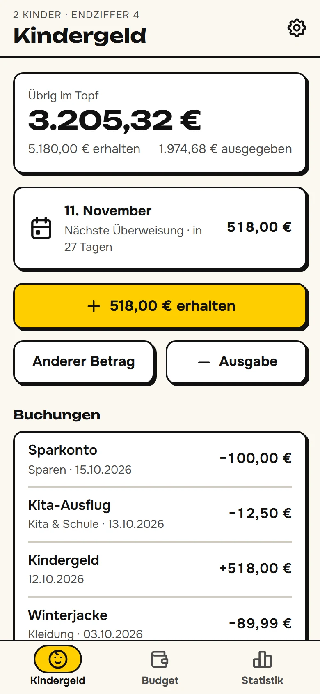
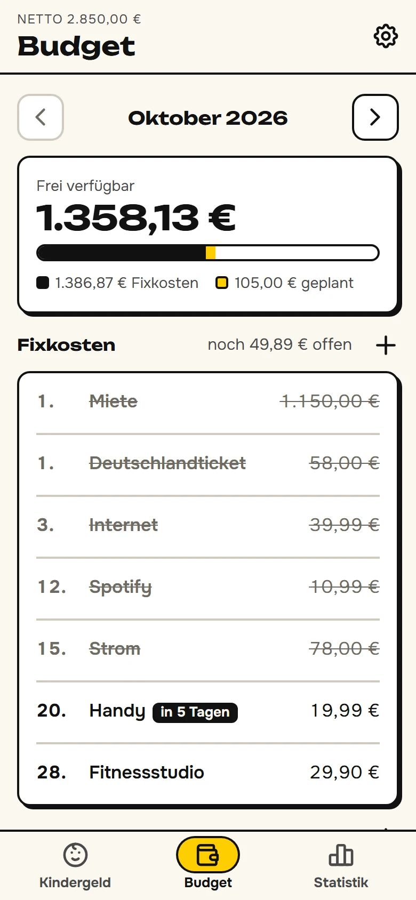
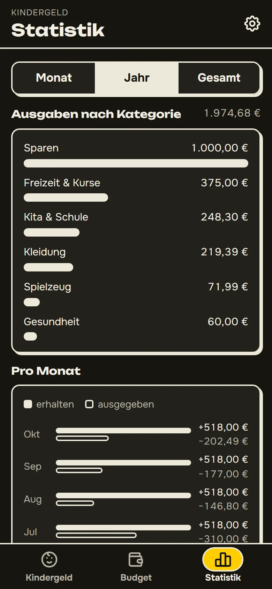
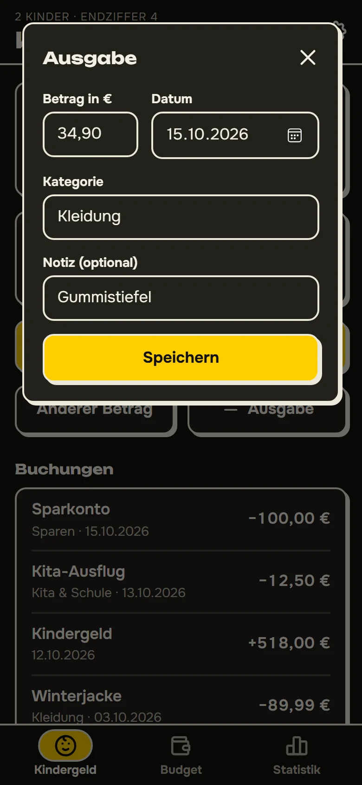

# Kassensturz

*Know what's left – of the Kindergeld and of the month.*

[](https://github.com/temvarin/kassensturz/actions/workflows/ci.yml)
[](LICENSE.md)

A household money app with two parts:
- **Kindergeld:** a pot for the children's Kindergeld that shows what came in, what was spent on what, and when the next payment arrives.
- **Budget:** a monthly budget that shows what is left of the salary after fixed costs and planned purchases.

It is an offline-capable web app (PWA) built with Blazor WebAssembly. The data lives on the phone; signed in, the family's phones sync through a small server on Azure.

**[Open the app →](https://kassensturz-temvarin-etcjhfhtguf4ard8.swedencentral-01.azurewebsites.net)** – and add it to your home screen to use it like an installed app ([how](#install-on-a-phone)).

| Kindergeld | Budget | Statistics | New spending |
|:---:|:---:|:---:|:---:|
|  |  |  |  |

## Why

Kindergeld arrives every month on a date that depends on the last digit of the Kindergeldnummer, and it is meant for the children. Keeping it as its own pot answers two questions: how much of it is still there, and where did the rest go?

The salary has a different question: what can still be spent this month? Rent, subscriptions and insurance leave the account on fixed days, and some purchases are planned in advance. Subtract both and the rest is the real room to spend.

## Features

- **Kindergeld pot:**
  - The balance, with totals received and spent.
  - One tap books a month of Kindergeld for all children (259 € each). Other amounts, such as a starting balance or a back payment, can be entered by hand.
  - Spendings by category: suggested categories plus your own.
  - The next payment date and a countdown, from the official schedule for your Endziffer.
- **Statistics:** spending per category for the month, the year or all time, and money in and out per month.
- **Monthly budget:**
  - The net salary, minus fixed costs with their debit day, minus purchases planned for the month, gives what is freely available.
  - Debited costs are struck through and the next one is marked.
  - Later months can be planned ahead.
- **Backups:** a backup file is saved through the phone's share sheet (Files, iCloud Drive, Google Drive) and can be loaded again on any device. A reminder appears when no backup was made in the last 30 days.
- **Sync between the family's phones:** signed in with Microsoft, both parents share one Kindergeld pot, and each budget stays private. Changes made offline go out with the next sync. Without signing in, nothing leaves the phone.
- **Works offline**, installs to the home screen on iPhone and Android, and follows the phone's dark mode. No tracking.

## Install on a phone

- **iPhone:** open the app in **Safari** → Share → *Add to Home Screen*.
- **Android:** open the app in **Chrome** → ⋮ menu → *Add to Home screen* → *Install*.

Use the installed app rather than a browser tab. Browsers treat installed apps' storage as more important, and on iPhone a tab and the installed app don't share data.

## Engineering highlights

- **All logic in a plain domain library.** `Geld.Domain` computes balances, statistics, payment dates and the month overview. The Razor pages only display it and pass user input back.
- **Encapsulated state.** State changes only through domain methods (`Receive`, `Spend`, `AddDeduction`, `Plan`), which keep the invariants: positive amounts, valid days, sorted lists. Setters are internal and exist for source-generated JSON.
- **A versioned data contract.** The stored data and the backup file are the same JSON document with a schema number. An unknown schema is refused instead of misread, and unreadable data starts the app fresh instead of crashing it. Sync requests carry a protocol number too: an outdated installed app is asked to restart instead of sending data in an old shape.
- **Sync without lost updates.** Each phone keeps the data as the server last confirmed it, and sends only what changed since, item by item and always as the item's whole new state, so a repeated request does no harm. The server applies the changes to its latest version and saves with a version check (compare-and-set); if another phone was faster, it applies them again. Changes made while a sync is under way are put back on top of the answer. Of two edits to the same item, the one the server receives last wins; phone clocks are never trusted.
- **The same rules on both sides.** The server checks every change with the domain code the app uses, so invalid data can't get in, even from a modified client.
- **No passwords to leak.** GitHub deploys through OIDC, the server reaches the database with a managed identity, and Microsoft handles sign-in (Easy Auth). A members list decides who gets in, a budget's key comes from the sign-in rather than the request, and the API accepts only JSON, which another website can't send along with the user's cookie.
- **Mistakes can be undone.** The database keeps every earlier version of a document for 6 months (a temporal table), and a tested script brings one back. The backup file stays as a copy outside the cloud.
- **Money done right.** Amounts are `decimal` and dates are `DateOnly`. German formatting and parsing are explicit and tested, without shipping culture data.
- **Deterministic tests.** The clock is an injected `TimeProvider`:
  - xUnit tests the domain, including a seeded randomised test in which three devices edit and sync in random order and must end up with exactly the server's data;
  - bUnit renders the pages against a fake clock, in-memory storage and a fake server, including the backup round trip and the sync's timing and retries;
  - the server runs in-process (`WebApplicationFactory`) against a real SQL Server: LocalDB on a developer's machine, a container in CI.
- **Honest about storage.** The app asks the browser for persistent storage and reminds the user to back up, because browsers may delete a web app's data without warning.
- **Strict build.** .NET analyzers at the recommended level, warnings are errors, trimming-safe.
- **Accessible.** Every text colour meets WCAG AA in light and dark mode, colour is never the only signal, and motion respects *reduce motion*.

## Architecture

One .NET 10 solution: a Blazor WebAssembly app and a small ASP.NET Core server, both on top of one domain library.

<picture>
  <source media="(prefers-color-scheme: dark)" srcset="docs/diagrams/architecture-dark.svg">
  
</picture>

- **Geld.Domain** (`src/Geld.Domain`):
  - `KindergeldPot`, `Budget`, and `Familienkasse` (the rate and the payment dates);
  - `Euro` (German amounts);
  - `AppData` and `DataStore` (persistence with a schema version);
  - the sync: the changes since the last sync, applying them, and the API's JSON.

  It has no UI and no I/O beyond a key-value interface, and the clock is passed in.
- **Geld.App** (`src/Geld.App`): Razor pages and components. Services are injected: state, storage, sync, dialogs, browser features and the clock. `browser.js` holds the browser features without a .NET counterpart: persistent storage, the share sheet, and noticing when the app comes back to the front. The app syncs at start, when it comes back to the front, and two seconds after a change.
- **Geld.Server** (`src/Geld.Server`): the ASP.NET Core host. It serves the app's files with Brotli compression and caching headers, and answers app routes like `/budget` with the start page. Under `/api` it learns from Easy Auth who is signed in, lets only the members through, and syncs: one shared Kindergeld document and one budget per member, each stored whole as JSON in Azure SQL.
- **db/**: the database schema, the app's database user (read and write only), and the restore script, run by hand in the Azure portal's query editor.

### Repository layout

```
src/
  Geld.Domain/           money, Kindergeld pot, budget, payment dates, storage
  Geld.App/              Blazor WebAssembly PWA: pages, components, services
  Geld.Server/           ASP.NET Core host for the app and the sync API
db/                      SQL scripts: schema, database user, restore
tests/
  Geld.Domain.Tests/     xUnit
  Geld.App.Tests/        bUnit component tests
  Geld.Server.Tests/     API and database tests (WebApplicationFactory, SQL Server)
docs/                    screenshots and diagrams
```

## Development

Requires the .NET 10 SDK and, for publishing, the WebAssembly build tools:

```bash
dotnet workload install wasm-tools
```

```bash
dotnet run --project src/Geld.App      # http://localhost:8081, the app alone
dotnet run --project src/Geld.Server   # http://localhost:8082, the app with the server's API
dotnet test
dotnet publish src/Geld.Server -c Release -o publish
```

The service worker only caches in the published app; in development every request goes to the server.

On the developer's machine there is no Microsoft sign-in: `Geld.Server` signs every request in as the user `dev` (see `Properties/launchSettings.json`, Development only) and syncs with a database on SQL Server LocalDB. The tests use LocalDB too, with a fresh database each run. Create the development database once:

```bash
sqlcmd -S "(localdb)\MSSQLLocalDB" -Q "CREATE DATABASE Kassensturz"
sqlcmd -S "(localdb)\MSSQLLocalDB" -d Kassensturz -i db/schema.sql
```

### Updating yearly data

The Familienkasse publishes the payment dates about a year ahead, and the Kindergeld rate changes from time to time. Both live in `src/Geld.Domain/Familienkasse.cs`:

1. Add the new months to `Schedule` from the [official table](https://www.arbeitsagentur.de/familie-und-kinder/auszahlungstermine), and update the retrieval date.
2. Update `MonthlyPerChild` when the rate changes.
3. Run `dotnet test`: a test checks that every date is a working day and that the dates rise with the Endziffer.

## Deployment

Every push to `main` runs CI (`.github/workflows/ci.yml`): tests and a Release publish of `Geld.Server`. If both pass, it is deployed to Azure App Service. The workflow signs in to Azure with a short-lived GitHub token (OIDC), so no Azure password is stored in GitHub. Pull requests are tested but not deployed.

The Azure resources, all in Sweden Central:
- **App Service, Free plan:** the web app, with Easy Auth for the Microsoft sign-in. Sign-in is limited to one Microsoft Entra directory, to which the second parent is invited as a guest. The app setting `Geld__Members` lists the user ids allowed to use the data.
- **Azure SQL, Basic:** the database, with the schema from `db/`. The web app logs in with its managed identity and may only read and write the documents.
- **Application Insights:** requests, errors and database calls, with a daily cap on the data it collects.

It costs about $5 a month, all for the database: the web app's plan is free, and monitoring stays within its free amount.

## Sources

- Kindergeld rate and payment dates: Bundesagentur für Arbeit / Familienkasse, [Auszahlungstermine](https://www.arbeitsagentur.de/familie-und-kinder/auszahlungstermine).
- This is a private project, not an official product of the Familienkasse.
- Fonts: [Onest](https://github.com/googlefonts/onest) and [Unbounded](https://github.com/googlefonts/unbounded) (SIL Open Font License, see `src/Geld.App/wwwroot/fonts/`).
- Icons: [Tabler Icons](https://tabler.io/icons) (MIT).

See [THIRD-PARTY-NOTICES.md](THIRD-PARTY-NOTICES.md).

## License

Source-available under the [PolyForm Noncommercial License 1.0.0](LICENSE.md): you may read, run and adapt it for noncommercial purposes, but not sell it or use it commercially. The fonts and the icons keep their own terms; see [THIRD-PARTY-NOTICES.md](THIRD-PARTY-NOTICES.md).
